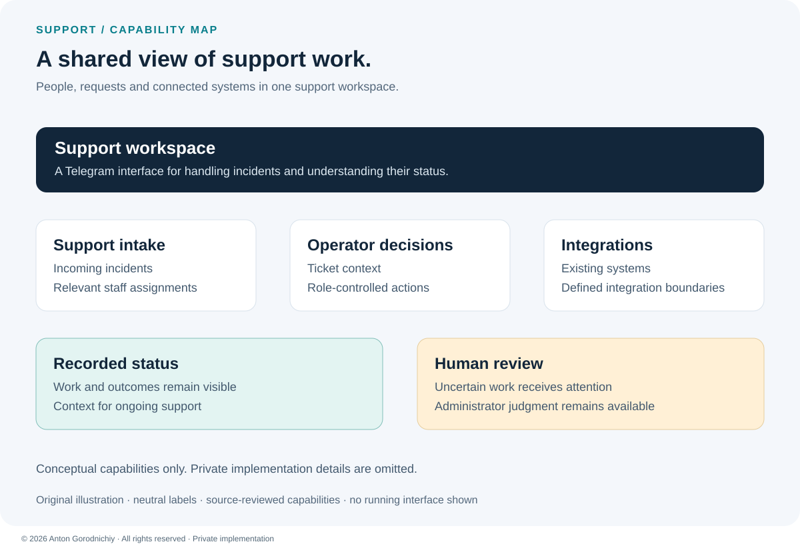
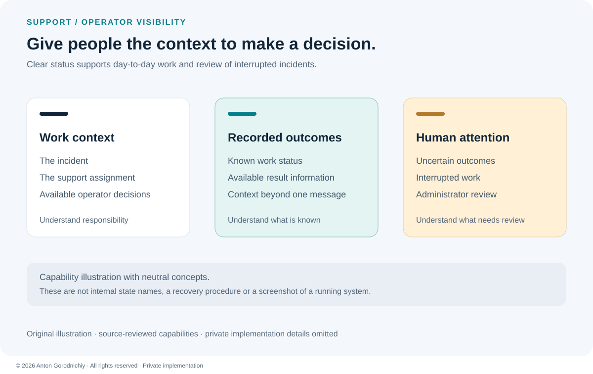

# Support Workflow Orchestrator

A Python support workspace that brings incidents, staff decisions and integration status together for clearer day-to-day operations.

**Private implementation — public case study. Source code is not publicly available.**

**Stack:** Python · pyTelegramBotAPI · Telethon · asyncio · httpx · SQLite · cryptography/Fernet  
**Status:** reviewed in source; execution not verified

## Problem → Solution → Result

| | Case |
| --- | --- |
| **Problem** | Support information is spread across messages, staff assignments and external systems. Operators need to understand who owns a request and which work needs attention. |
| **Solution** | A Telegram support interface with role-controlled decisions, integration boundaries, recorded status and administrator review. |
| **Result** | The source contains a connected support workflow with incident routing, duplicate-action safeguards and visibility of interrupted work. Runtime reliability and live integration behavior remain unverified. |

## Capabilities at a glance

*Original capability illustration with neutral labels. It does not show the private implementation or a running interface.*

- **Support intake:** connect incoming incidents with the relevant support assignment.
- **Operator decisions:** provide ticket actions that respect staff permissions.
- **Integration boundaries:** connect existing systems through dedicated adapters.
- **Recorded status:** keep work and outcomes visible beyond the current interaction.
- **Human review:** make uncertain or interrupted work available for administrator attention.

## Engineering focus

**Clear responsibility.** Support roles, ticket context and integration boundaries help keep operator actions understandable and maintainable.

**Visible uncertainty.** The workflow distinguishes recorded outcomes from work that needs investigation. That supports informed human decisions when external systems are unreliable. Implementation and recovery details remain private.

*Original explanatory illustration. These are capability concepts, not internal state names or an execution sequence.*

## My contribution

I defined the support requirements, designed the incident workflow and implemented the operator interface and integrations. I worked on permissions, status visibility and failure diagnosis, using manual testing and debugging during development. This publication reviews the source; it does not reproduce those earlier testing sessions.

## What I can build for a client

- A Telegram support bot with staff assignments, incident status and administrator controls.
- An integration service with recorded outcomes and duplicate-action safeguards.
- An internal operations tool that connects existing systems and highlights work needing human review.

## Status & limitations

This is a substantial integration MVP. **reviewed in source; execution not verified** applies to the application and its existing tests.

- No live accounts, equipment or diagnostic calls were used for this case study. Integration compatibility, deployment readiness, load and service levels remain unverified. Existing private tests were not run.
- Known maintenance debt remains in database helpers and large modules. Simultaneous use needs further testing.
- Credential protection has a limited scope. Deployment security and access to private account data need separate review.
- Interrupted work can require administrator judgment. Fully automatic recovery is not established.

[Discuss a similar integration](CONTACT.md)

© 2026 Anton Gorodnichiy. All rights reserved. [Rights and reuse](RIGHTS.md).
