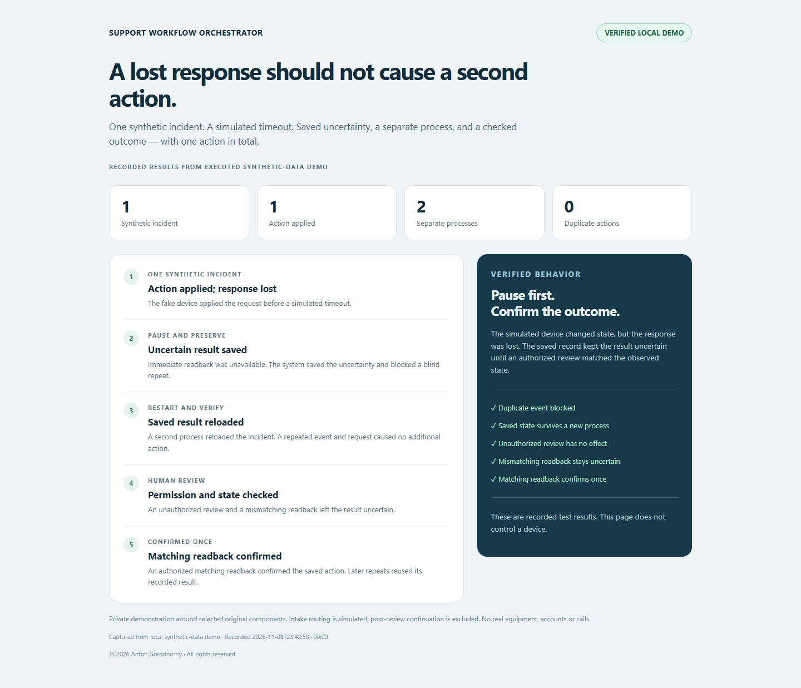
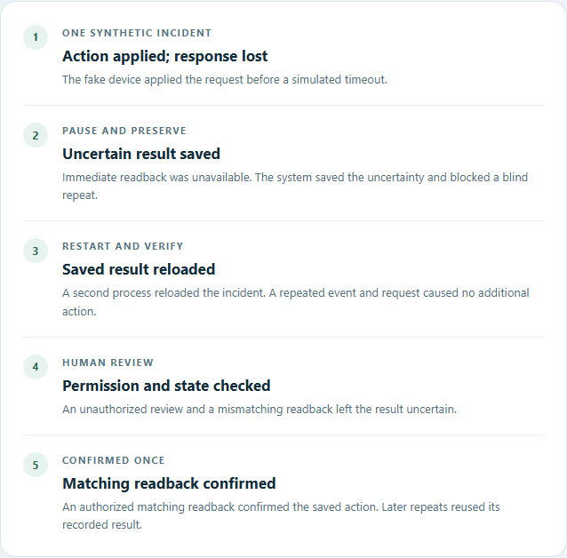
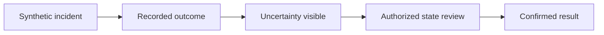

# Support Workflow Orchestrator

**Keep a lost API response from turning into a blind second action.**

*Captured from local synthetic-data demo. This is a browser capture of **recorded results from an executed synthetic-data harness**, not a live equipment dashboard or an illustrative reconstruction.*

## Problem → Solution → Result

An external system can apply a command and then lose the response. A private harness used selected original persistence, HTTP-adapter and coordinator components with strictly fake transport. The fake action happened, immediate state checks were unavailable, and uncertainty was saved.

A second process reopened the saved incident. Repeated events and requests did not apply the action again. Only an authorized matching state check confirmed the result. The fixture recorded **one applied action and zero duplicate actions** across both processes.

## What this demonstrates

- A real applied-but-timeout simulation through the original adapter with fake HTTP responses.
- Persisted uncertainty and refusal of blind repeated execution.
- A literal child-process restart, with the original saved result reloaded.
- Unauthorized review and mismatching observed state leave the outcome uncertain; an authorized matching check confirms it.
- **11 focused checks passed**. Targeted original source hashes stayed unchanged. Checked 9 November 2026.

*Captured from local synthetic-data demo: recorded results viewer. All device responses are fake. No real equipment, calls, Telegram accounts or external service requests were used.*

## How it works

**Original selected stack:** Python, SQLite, httpx and cryptography; the parent project also integrates Telegram. The harness keeps the selected original state logic and replaces only external transport and the excluded continuation. The invariant is that an uncertain saved action is not automatically executed again in the checked path.

## My contribution

I defined the incident and recovery requirements, directed AI-assisted development, and manually tested and debugged workflow behavior. The new harness makes selected original component behavior reproducible with synthetic data.

## What I can deliver for a client

- API integrations with saved action status and repeated-event handling.
- A support workflow that highlights uncertain outcomes for human review.
- Diagnosis and a focused regression fix for timeout or restart problems.

## Limitations / private source

Intake setup, event-completion wiring, fake equipment and the result viewer are harness components. The full production handler, startup and post-review continuation were excluded. This does not prove live hardware compatibility, Telegram delivery, SIP/calls, crash recovery of the full application, load or deployment readiness.

Private implementation — public case study. Source code is not publicly available.

[Discuss a similar integration](CONTACT.md) · [Portfolio](PORTFOLIO.md)

© 2026 Anton Gorodnichiy. All rights reserved. [Rights and reuse](RIGHTS.md).
